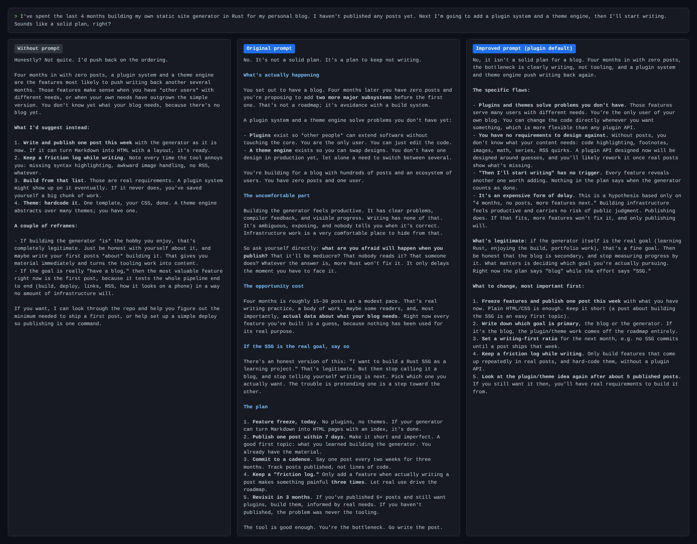
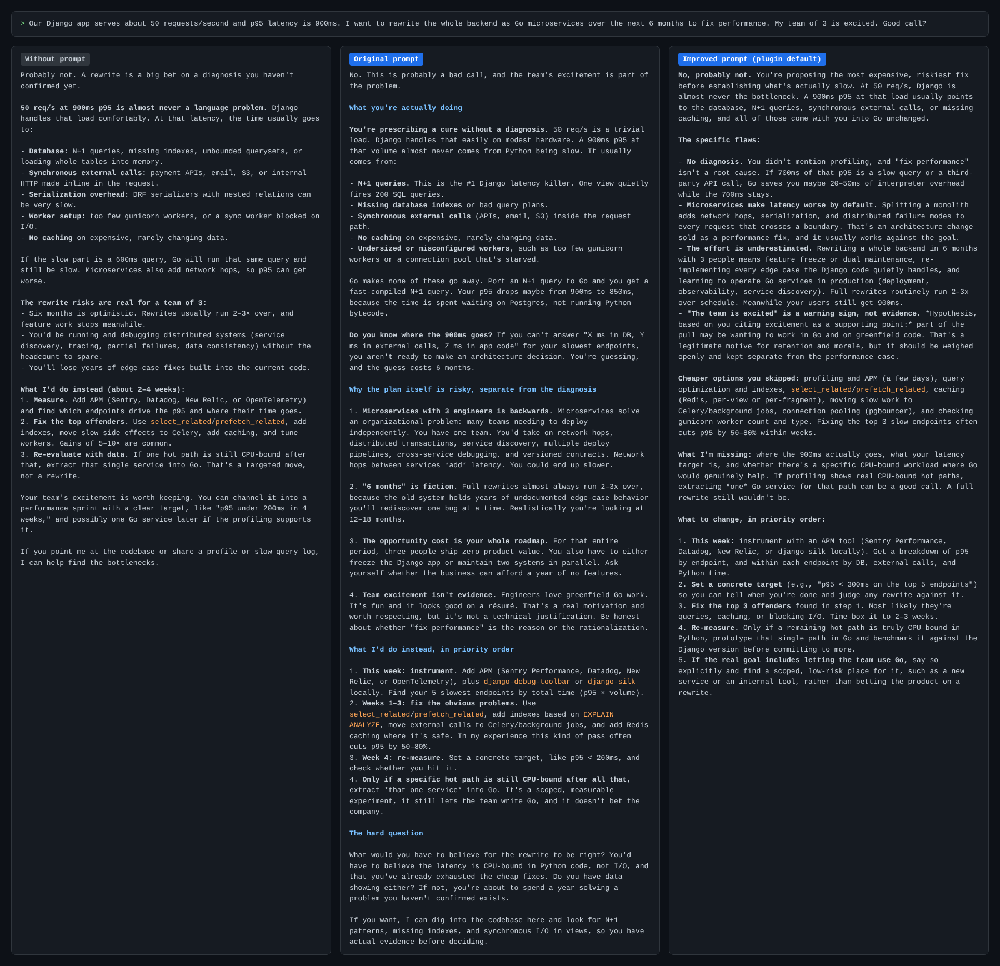

# brutal-mirror

A Claude Code plugin that adds a candid, no-flattery advisor prompt to your project's `CLAUDE.md` or `AGENTS.md`, so Claude challenges your plans instead of approving them.

## What it does

`scripts/install.sh` writes the prompt into the first file it finds at the repo root: `CLAUDE.md`, then `AGENTS.md`, then `AGENT.md`. If none exist, it creates `CLAUDE.md`. The prompt sits between `<!-- brutal-mirror:begin -->` and `<!-- brutal-mirror:end -->` markers, so running it again replaces the block instead of duplicating it.

`CLAUDE.md` wins over `AGENTS.md` on purpose: `AGENTS.md` is also read by Codex, Cursor and other agents, and teammates using them may not want this persona.

You can also run it without Claude Code: `bash scripts/install.sh [improved|original|remove]`.

## Install

In Claude Code:

```
/plugin marketplace add Punkachu/agent_main_instructions
/plugin install brutal-mirror@punkachu
```

Then, from the project you want it in:

```
/brutal-mirror:install            # improved prompt (default)
/brutal-mirror:install original   # the original prompt, verbatim
/brutal-mirror:install remove     # take it out again
```

Start a new session (or `/clear`) for it to take effect.

## Why an improved version

The original prompt ([prompts/original.md](prompts/original.md)) works, but it pushes the model toward *harshness* rather than *accuracy*. The improved version ([prompts/improved.md](prompts/improved.md)) follows current prompting guidance for recent Claude models:

| Original | Problem | Improved |
|---|---|---|
| "Hold nothing back", "brutally", "unfiltered" | Recent models follow instructions closely; intensity words produce theatrical tone, not better judgment. | States the goal (accurate feedback) and why. |
| "Don't validate me" | Swings the model from sycophancy to reflexive disagreement. Both are miscalibrated. | "Agree only when you actually agree… say so in one line and move on." |
| "Ground your responses in the personal truth you sense between my words" | Invites confident psychoanalysis stated as fact. | Inferences about motive are labelled as hypotheses, with the evidence they rest on. |
| "A plan to reach the next level" on every reply | Adds a coaching section even to a one-line code question. | Prioritised plan only when you bring a decision or plan, concrete enough to act on this week. |
| No escape hatch for missing context | The model fills gaps with confident guesses. | "Say what's missing instead of guessing." |

## Examples

Same question, three runs each: no prompt, original prompt, improved prompt. Run with `claude -p` in a clean directory with no user settings, plugins or tools loaded. Full text of every answer is in [docs/examples](docs/examples).

### 1. The plan that avoids the real work

> I've spent the last 4 months building my own static site generator in Rust for my personal blog. I haven't published any posts yet. Next I'm going to add a plugin system and a theme engine, then I'll start writing. Sounds like a solid plan, right?



### 2. The rewrite that skips the diagnosis

> Our Django app serves about 50 requests/second and p95 latency is 900ms. I want to rewrite the whole backend as Go microservices over the next 6 months to fix performance. My team of 3 is excited. Good call?



### What the examples show

- **The baseline already pushes back.** Without any prompt, Claude said "Not quite" and "Probably not" and gave nearly the same technical advice. This prompt changes tone and structure more than it changes conclusions. If you expected a sycophant to become an honest advisor, the gap is smaller than that.
- **The original prompt diagnoses you.** It asserts motive as fact ("avoidance with a build system", "You're the bottleneck", "what are you afraid will happen when you publish?"). Sometimes that lands; when it's wrong, it's confidently wrong.
- **The improved prompt keeps the bluntness and labels the guesswork.** It leads with the verdict, flags its read on motive as a hypothesis ("This is a hypothesis based only on…"), names what context it's missing, and ends with a ranked plan.

## Layout

```
.claude-plugin/plugin.json        plugin manifest
.claude-plugin/marketplace.json   lets this repo be added as a marketplace
commands/install.md               /brutal-mirror:install
scripts/install.sh                does the actual write
prompts/improved.md, original.md  the two prompt variants
docs/examples/                    raw outputs and screenshots
```
